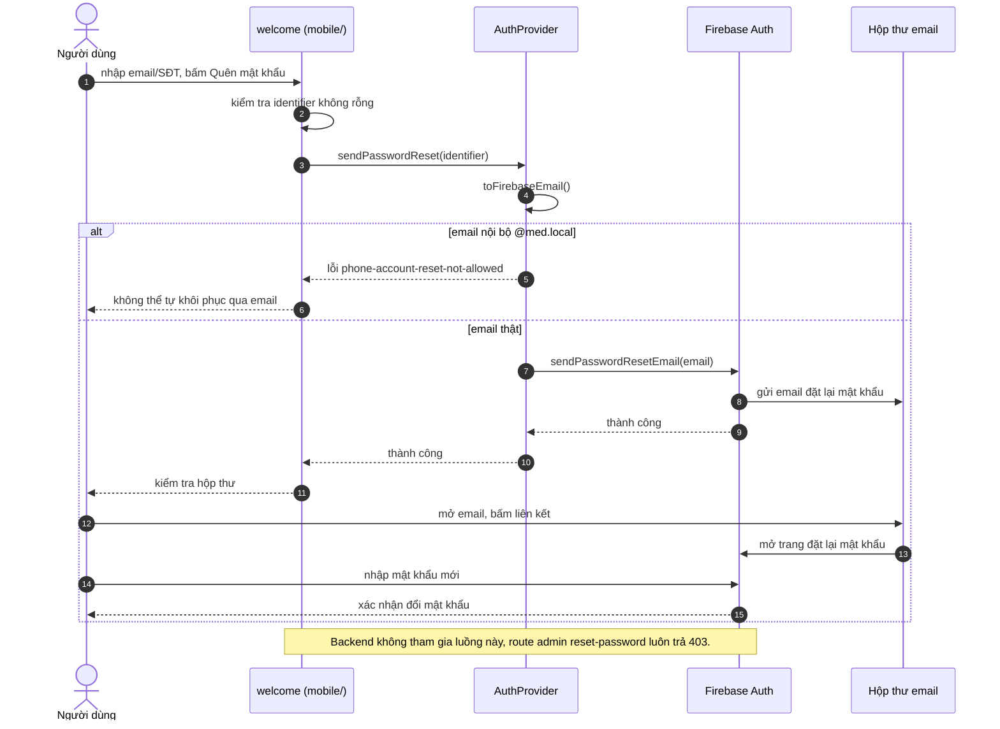
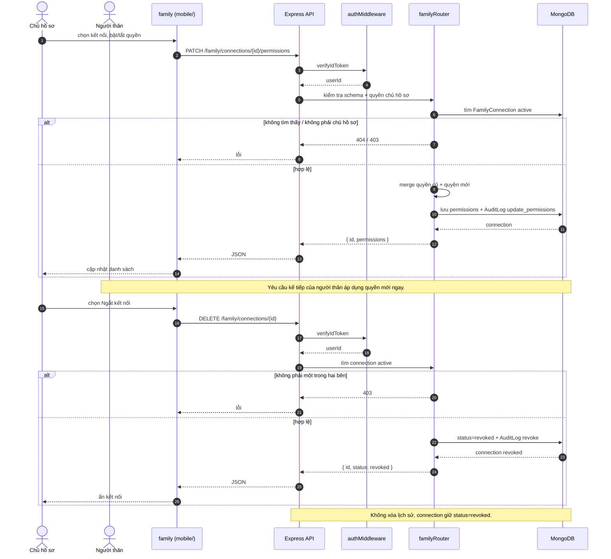
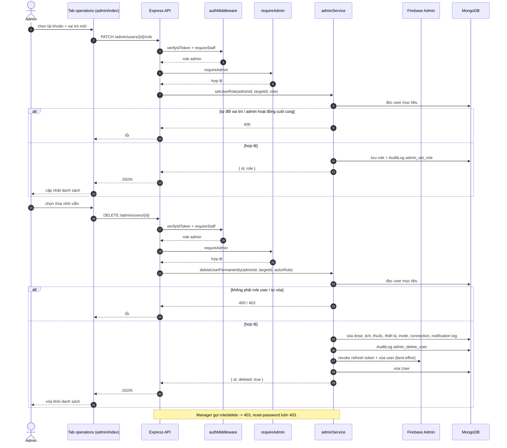

# API SPEC — Backend Node.js/Express (TypeScript)

## 1. Quy ước chung

- Base URL: `/api/v1`
- Mọi endpoint yêu cầu header `Authorization: Bearer <Firebase ID token>` — **trừ** `GET /health` và `POST /auth/refresh-profile` (ghi rõ bên dưới).
- Content-Type: `application/json`

### Phản hồi thành công

```json
{ "success": true, "data": { } }
```

### Phản hồi lỗi

```json
{ "success": false, "error": { "code": "VALIDATION_ERROR", "message": "Tên thuốc không được để trống" } }
```

| Mã lỗi HTTP | Code | Khi nào |
|---|---|---|
| 400 | VALIDATION_ERROR | Dữ liệu đầu vào không hợp lệ |
| 401 | UNAUTHENTICATED | Thiếu hoặc sai ID token |
| 403 | FORBIDDEN | Hợp lệ nhưng không có quyền trên dữ liệu |
| 404 | NOT_FOUND | Không tìm thấy tài nguyên |
| 409 | CONFLICT | Xung đột (trùng xác nhận, trạng thái không cho phép) |
| 429 | RATE_LIMITED | Quá số yêu cầu (mã mời, đăng nhập) |
| 503 | SERVICE_UNAVAILABLE | Firebase Admin chưa cấu hình/chưa kết nối được (khóa/mở tài khoản) |
| 500 | INTERNAL_ERROR | Lỗi server |

### Phân quyền

| Nhóm | Yêu cầu |
|---|---|
| Chủ hồ sơ | Token UID khớp `user_id` của tài nguyên |
| Người thân | UID có `family_connections` active với owner và `permissions.view_schedule=true` (xem) hoặc `manage_medication=true` (sửa — mở rộng) |
| Quản lý vận hành | `users.role = 'manager'` — xem số liệu/danh sách, khóa/mở tài khoản người dùng; **không** đặt lại mật khẩu, không đổi vai trò, không đọc nội dung y tế chi tiết |
| Quản trị hệ thống | `users.role = 'admin'` — toàn bộ khu vực `/api/v1/admin`, gồm đổi vai trò và xóa vĩnh viễn tài khoản `user`; route đặt lại mật khẩu luôn trả 403; không đọc nội dung y tế chi tiết |

## 2. Bảng endpoint

### 2.1 Công khai / hệ thống

| Method | Path | Quyền | Mô tả |
|---|---|---|---|
| GET | /health | Public | Health check: `{ status, uptime, db }` |

### 2.2 Người dùng và tùy chọn

| Method | Path | Quyền | Input | Output |
|---|---|---|---|---|
| POST | /users/me/sync | Đã đăng nhập Firebase | `{ displayName?, phone?, address?, timezone?, preferences? }` | Tạo/cập nhật bản ghi user theo firebase_uid (idempotent). `phone` chuẩn hoá `0xxxxxxxxx` (nhận `+84…`); `phone`/`address` rỗng = null |
| GET | /users/me | Chủ hồ sơ | — | `{ id, phone, displayName, address, timezone, preferences, role }` (`role`: `'user' \| 'manager' \| 'admin'`) |
| PATCH | /users/me | Chủ hồ sơ | `{ displayName?, phone?, address?, timezone?, preferences? }` | Cập nhật tùy chọn M08. `phone` sai định dạng → 400; `phone`/`address` = `""`/`null` để xoá |

### 2.3 Thuốc

| Method | Path | Quyền | Input | Output |
|---|---|---|---|---|
| GET | /medications | Chủ hồ sơ hoặc người thân (view) | Query: `?status=active\|discontinued&page=` | Danh sách + phân trang |
| POST | /medications | Chủ hồ sơ hoặc người thân (manage — mở rộng) | `{ name, imageUrl?, dosageText?, instructions?, startDate, endDate?, schedules: [{ timeOfDay, recurrenceRule }] }` | Thuốc vừa tạo kèm lịch |
| GET | /medications/:id | Owner hoặc người thân (view) | — | Chi tiết thuốc + lịch |
| PATCH | /medications/:id | Owner hoặc người thân (manage — mở rộng) | Các trường thay đổi (`endDate: null` để bỏ hạn) | Cập nhật; ghi audit_log |
| POST | /medications/:id/discontinue | Owner hoặc người thân (manage — mở rộng) | `{ reason? }` | Ngừng thuốc; lịch → archived; lịch sử giữ nguyên |
| POST | /medications/:id/schedules | Owner hồ sơ hoặc người thân (manage — mở rộng) | `{ timeOfDay, recurrenceRule?, effectiveFrom?, effectiveTo? }` | Thêm một giờ/lịch vào thuốc đã có (M05 sửa); sinh lần uống tương lai; trùng giờ → 409 |

### 2.4 Lịch uống

| Method | Path | Quyền | Input | Output |
|---|---|---|---|---|
| GET | /schedules | Owner hoặc người thân (view) | Query: `?medicationId=&status=` | Danh sách lịch |
| PUT | /medications/schedules/:id | Owner hồ sơ hoặc người thân (manage — mở rộng) | `{ timeOfDay, recurrenceRule, effectiveFrom, effectiveTo? }` | Tạo phiên bản mới (version+1); lịch sử cũ giữ nguyên; hủy/sinh lại lần uống tương lai theo phiên bản mới |
| DELETE | /medications/schedules/:id | Owner hồ sơ hoặc người thân (manage — mở rộng) | — | Ngừng một giờ/lịch (M05 sửa): lịch → archived; xóa lần uống tương lai; giữ lịch sử; trả `removedFutureDoses` |

### 2.5 Lần uống

| Method | Path | Quyền | Input | Output |
|---|---|---|---|---|
| GET | /doses/today | Owner hoặc người thân (view) | — | Các lần uống hôm nay, thống kê `{ confirmed, remaining, total }` theo múi giờ người dùng |
| GET | /doses | Owner hoặc người thân (view) | Query: `?date=YYYY-MM-DD&medicationId=&page=&pageSize=` | Lịch theo ngày (M03) |
| GET | /doses/:id | Owner hoặc người thân (view) | — | Một lần uống kèm `medicationName`, `dosageText`, `instructions` (dùng cho M02). **Không cần `?ownerId=`**: nếu không truyền thì suy ra chủ hồ sơ từ chính lần uống → người thân có `view_schedule` mở được lần uống của chủ hồ sơ (bấm từ notification). Thêm `canAct` (false khi người xem là người thân → giao diện chỉ xem) và `timezone` (múi giờ của **chủ hồ sơ**) |
| POST | /doses/:id/confirm | Owner | `{ clientRequestId }` | Xác nhận đã uống. Idempotent: `clientRequestId` trùng → trả về kết quả cũ, không tạo bản thứ hai. Output: lần uống đã cập nhật |
| POST | /doses/:id/snooze | Owner | `{ minutes? }` | Nhắc lại sau (mặc định 10 phút *(đề xuất)*, tối đa 3 lần). Output: lần uống đã cập nhật |
| POST | /doses/:id/cannot-take | Owner | `{ reason }` | Không thể uống; `reason` bắt buộc 1–500 ký tự |

### 2.6 Lịch sử

| Method | Path | Quyền | Input | Output |
|---|---|---|---|---|
| GET | /history | Owner hoặc người thân (view) | Query: `?from=&to=&medicationId=&page=&pageSize=` (pageSize tối đa 50) | Danh sách lần uống quá khứ; phân biệt giờ dự kiến / giờ gửi nhắc / giờ xác nhận |

### 2.7 Người thân và kết nối

| Method | Path | Quyền | Input | Output |
|---|---|---|---|---|
| POST | /family/invites | Owner hồ sơ | — | Tạo mã 6 chữ số có hạn *(15 phút — Q8)*; mã cũ tự vô hiệu; chỉ trả về mã một lần |
| POST | /family/invites/:code/accept | Người thân (đã đăng nhập) | — | Chấp nhận; tạo connection active; xem Q8 |
| GET | /family/connections | Cả hai bên của kết nối | — | Danh sách người thân đã kết nối; mỗi dòng có `role` (của người gọi), `user.{id,displayName,phone,timezone}` (người kia) — `timezone` để web tính ngày/buổi khi người thân xem lịch hộ |
| PATCH | /family/connections/:id/permissions | Owner hồ sơ | `{ viewSchedule?, manageMedication?, relativeAlerts? }` | Đổi quyền; có hiệu lực ngay ở yêu cầu kế tiếp; ghi audit_log |
| DELETE | /family/connections/:id | Owner hồ sơ hoặc người thân | — | Ngắt kết nối (revoke); thu hồi quyền ngay; ghi audit_log |

### 2.8 Thiết bị và thông báo

| Method | Path | Quyền | Input | Output |
|---|---|---|---|---|
| POST | /users/devices/register | Đã đăng nhập Firebase | `{ fcmToken, platform: "web", userAgent? }` | Đăng ký/ cập nhật token Web Push |
| DELETE | /users/devices/unregister | Owner của token | Body: `{ fcmToken }` | Xóa token khi đăng xuất |
| PATCH | /users/me/notification-settings | Chủ hồ sơ | `{ snoozeMinutes?: 5–30, snoozeMax?: 1–5 }` | Cài đặt nhắc lại (M08) — merge vào `users.preferences`; backend tuân theo khi snooze |

> Ghi chú: route thiết bị nằm dưới `/users` (mount tại `/api/v1/users`) — đường dẫn đầy đủ là `/api/v1/users/devices/register` và `/api/v1/users/devices/unregister`.

### 2.9 Khu vực vận hành — `manager` và `admin`

Khu vực hậu trường `/admin`. Mọi route dưới đây qua `requireAuthMiddleware` + `requireStaffMiddleware` (`manager` hoặc `admin`); người dùng thường nhận **403 FORBIDDEN**, chưa đăng nhập nhận **401 UNAUTHENTICATED**. Đổi vai trò và xóa tài khoản qua thêm `requireAdminMiddleware` — `manager` gọi hai route này nhận **403**. Route đặt lại mật khẩu tồn tại nhưng luôn trả **403** vì lý do bảo mật.

| Method | Path | Quyền | Input | Output |
|---|---|---|---|---|
| GET | /admin/summary | Manager/Admin | — | `{ users, disabledUsers, activeMedications, doses24h, confirmed24h, activeConnections, activeDevices, failedNotifications24h }` — chỉ số đếm; các số `24h` chỉ tính **24 giờ đã qua** (không gồm liều tương lai) |
| GET | /admin/users | Manager/Admin | Query: `?q=&page=&pageSize=` (`pageSize` ≤ 50) | `{ items: [{ id, displayName, phone, email, role, disabled, timezone, createdAt, medicationsActive, doses7d, confirmed7d, devicesActive }], page, pageSize, total }`. `role`: `'user' \| 'manager' \| 'admin'`. Tìm theo tên/SĐT. **Không** trả tên thuốc, ghi chú, lý do không uống. `email` đọc một lần từ Firebase Admin (không lưu trong MongoDB); Firebase lỗi → `email = null`, trang vẫn hoạt động |
| PATCH | /admin/users/:id/status | Manager/Admin | `{ disabled: boolean }` | Khóa/mở tài khoản: gọi Firebase `updateUser(uid, { disabled })`, thu hồi refresh token khi khóa, lưu `users.disabled_at`, ghi `audit_logs` (`admin_lock`/`admin_unlock`). Không thể tự khóa chính mình → 400. **Manager** chỉ thao tác được tài khoản `role='user'`; tài khoản `manager`/`admin` → 403 |
| POST | /admin/users/:id/reset-password | Admin | — | **Luôn trả 403 FORBIDDEN** vì lý do bảo mật; quản trị viên không được đổi/đặt lại mật khẩu của người dùng. Người dùng tự đổi mật khẩu trong Hồ sơ/Cài đặt hoặc dùng “Quên mật khẩu” ở màn hình đăng nhập. Manager → 403 |
| PATCH | /admin/users/:id/role | Admin | `{ role: 'user' \| 'manager' \| 'admin' }` | Đổi vai trò trong MongoDB; ghi `audit_logs` (`admin_set_role`, `details.from/to`). Không thể tự đổi vai trò của mình → 400; không thể hạ quyền admin đang hoạt động cuối cùng → 400. Manager → 403 |
| DELETE | /admin/users/:id | Admin | — | Xóa vĩnh viễn tài khoản `role='user'`: xóa dose, lịch, thuốc, thiết bị, mã mời, kết nối, notification log; ghi `audit_logs` (`admin_delete_user`); thu hồi refresh token + xóa Firebase user (best-effort); xóa `users`. Không thể tự xóa mình hoặc xóa tài khoản manager/admin → 400. Manager → 403 |
| GET | /admin/notifications | Manager/Admin | Query: `?limit=` (≤ 100, mặc định 20) | Các `notification_logs` có `status='failed'`, mới nhất trước: `{ id, kind, channel, sentAt, error, errorCode, doseId }`; `error` là **nhãn tiếng Việt** để hiển thị, `errorCode` là mã gốc (`no_active_device`, `messaging/...`) để tra cứu |
| GET | /admin/audit-logs | Manager/Admin | Query: `?limit=` (≤ 100, mặc định 20) | Nhật ký thao tác gần đây: `{ id, action, entity, entityId, actorName, actorPhone, createdAt, details }`. `actorName/actorPhone` là tên tài khoản bị tác động; `details.admin_id` là tài khoản đã thao tác; `details.admin_role` cho biết `manager`/`admin` (không trả mật khẩu) |

**Khóa tài khoản**: ngoài việc chặn đăng nhập lại ở Firebase, backend kiểm tra `users.disabled_at` ngay trong `authMiddleware` → mọi API (kể cả `/users/me/sync`) trả **403 FORBIDDEN** với thông báo “Tài khoản đã bị khóa…”. Token cũ có hiệu lực tối đa 1 giờ nhưng không dùng được API trong thời gian đó.

**Cấp/đổi vai trò**: admin có thể đổi trong `/admin` (có audit), hoặc dùng CLI:

```bash
cd backend
npm run admin:grant -- ban@example.com                 # mặc định admin
npm run admin:grant -- 0912345678 --role manager       # cấp quản lý
npm run role:set -- ban@example.com --role user        # hạ về người dùng
```

Script tìm user qua Firebase (email) hoặc `users.phone` (SĐT) rồi đặt `role`. Không có endpoint tự cấp quyền. Không thể hạ quyền admin đang hoạt động cuối cùng.

**Firebase Admin chưa cấu hình** → khóa/mở tài khoản trả **503 SERVICE_UNAVAILABLE**; các route chỉ đọc vẫn chạy (trừ email = null).

### 2.10 Sức khỏe — nhật ký sau uống thuốc

Chỉ chủ hồ sơ truy cập nhật ký của chính mình; không hỗ trợ `?ownerId=` cho người thân. Mỗi lần uống đã xác nhận có thể sinh một `health_logs` để hỏi cảm giác sau uống.

| Method | Path | Quyền | Input | Output |
|---|---|---|---|---|
| GET | /health-logs | Chủ hồ sơ | Query: `?from=&to=&page=&pageSize=` (`from/to` dạng `YYYY-MM-DD`, `pageSize` ≤ 50) | `{ items: [{ id, doseId, medicationId, medicationName, kind, scheduledAt, confirmedAt, askedAt, question, answer, answerNote, answeredAt }], page, pageSize, total }` |
| PATCH | /health-logs/:id | Chủ hồ sơ | `{ answer: 'good' \| 'tired' \| 'dizzy' \| 'unwell' \| 'other', note?: string (≤ 500) }` | Cập nhật câu trả lời + `answered_at`; không tìm thấy log của mình → 404 |

## 3. Yêu cầu kỹ thuật

1. **Idempotency**: `POST /doses/:id/confirm` yêu cầu `clientRequestId` (UUID do web sinh). Server lưu tạm theo `(user_id, dose_id, clientRequestId)`; lặp lại trả về kết quả cũ với HTTP 200.
2. **Validation**: mọi input qua middleware validation (ví dụ zod/joi — chọn khi BUILD); lỗi → 400 VALIDATION_ERROR.
3. **Phân quyền**: middleware xác minh token → gắn `req.user`; middleware kiểm tra quyền theo owner hoặc connection trước controller.
4. **Không lộ dữ liệu nhạy cảm**: response không gồm `firebase_uid` của người khác, `code_hash`, token FCM web; log không ghi body chứa lý do sức khỏe đầy đủ.
5. **Rate limit**: `/family/invites` tối đa 5 lần/phút; endpoint đăng nhập do Firebase quản lý.
6. **Nhất quán dữ liệu**: thao tác đổi trạng thái lần uống dùng **atomic update** (`findOneAndUpdate` + filter trạng thái); sinh/xóa lần uống theo lịch mới chạy tuần tự (standalone MongoDB không hỗ trợ transaction — chấp nhận cho MVP).

7. **Múi giờ**: mọi ngày/giờ nhập theo giờ địa phương của người dùng (`users.timezone`, mặc định `TZ_DEFAULT`) được quy đổi sang UTC **trước khi lưu** (ví dụ 08:00 giờ VN → `01:00Z`). Mọi khoảng ngày khi lọc (`/doses/today`, `/doses?date=`, `/history?from&to`) tính theo `00:00 – 23:59:59.999` **giờ địa phương** của người dùng, không dùng mốc UTC. Khi đọc hộ người thân, mốc ngày tính theo múi giờ **của chủ hồ sơ**.

8. **Xem hộ người thân (`?ownerId=`)**: các endpoint **đọc** (`GET /doses/today`, `GET /doses`, `GET /doses/:id`, `GET /medications`, `GET /medications/:id`, `GET /history`) nhận query tùy chọn `?ownerId=<id>`. Không truyền (hoặc trùng chính mình) → đọc dữ liệu của mình. Truyền id khác → yêu cầu kết nối `active` với quyền `view_schedule`, thiếu → **403**. Riêng `GET /doses/:id` không truyền `?ownerId=` thì **suy ra chủ hồ sơ từ chính lần uống** (cho phép người thân bấm từ notification mở thẳng M02). Các endpoint **ghi/sửa thuốc** cũng nhận `?ownerId=` nhưng đòi quyền `manage_medication` (MVP = false → 403); ghi lần uống (xác nhận/nhắc lại/không thể uống) chỉ dành cho chủ hồ sơ. Phản hồi đọc hộ gắn cờ `canAct=false` để giao diện **chỉ xem**.

9. **Thông báo người thân (relative alert)**: chỉ **không gửi** khi lần uống đã `confirmed` (đã xác nhận uống thuốc). Mọi trạng thái còn lại — `pending`/`snoozed`/`overdue`/`missed`/`cannot_take` (không uống được, đang bận…) — đều báo cho người thân. Với lần uống chưa xác nhận quá `RELATIVE_ALERT_AFTER_MINUTES` phút (mặc định **10**, cấu hình ở `backend/.env`) server gửi push tới thiết bị của mọi người thân có kết nối `active` với `permissions.relative_alerts=true` (mặc định bật); mốc tính là giờ đến hạn **cuối cùng** (`snoozed_until` nếu đã “nhắc lại sau”). Khi chủ hồ sơ bấm “không thể uống”, server gửi ngay (nếu chưa từng gửi cảnh báo cho lần uống đó) và cron vẫn có lưới an toàn để thử lại. Chống trùng theo `(dose_id, kind='relative_alert')` — mỗi lần uống tối đa một push; nếu tới lúc chuyển `missed` (30 phút) mà chưa từng gửi thì vẫn báo. Đây là push phía server, không có endpoint riêng.

10. **Quản trị tối thiểu dữ liệu**: route vận hành **không** trả nội dung y tế (tên thuốc, hướng dẫn, lý do không uống) và **không** trả token FCM, `firebase_uid` của người khác. Quản trị viên **không** đặt lại mật khẩu hộ người dùng; route `reset-password` luôn trả 403. Mọi thao tác khóa/mở/đổi vai trò/xóa tài khoản đều ghi `audit_logs` với `details.admin_id`.

---

## Điểm cần duyệt

1. Danh sách endpoint ở mục 2 (bao gồm nhóm vận hành 2.9 và nhóm sức khỏe 2.10).
2. Bắt buộc `clientRequestId` cho xác nhận (idempotency).
3. Người thân chỉ có quyền xem ở MVP; `manage_medication` chỉ mở ở mở rộng.
4. Rate limit mã mời 5 lần/phút.
5. **Đã duyệt 20/10/2026, mở rộng 27/10/2026**: khu vực vận hành `/admin` ngoài M01–M08 — manager xem số liệu/danh sách + khóa/mở tài khoản người dùng; admin thêm đổi vai trò và xóa vĩnh viễn tài khoản `user`. Thêm `users.role` (`user`/`manager`/`admin`) và `users.disabled_at`. Route đặt lại mật khẩu tồn tại nhưng luôn trả 403 vì lý do bảo mật.

---

## 4. Sơ đồ trình tự bổ sung

### 4.1 Quên / đặt lại mật khẩu



### 4.2 Đổi quyền và ngắt kết nối người thân



### 4.3 Admin đổi vai trò và xóa tài khoản


