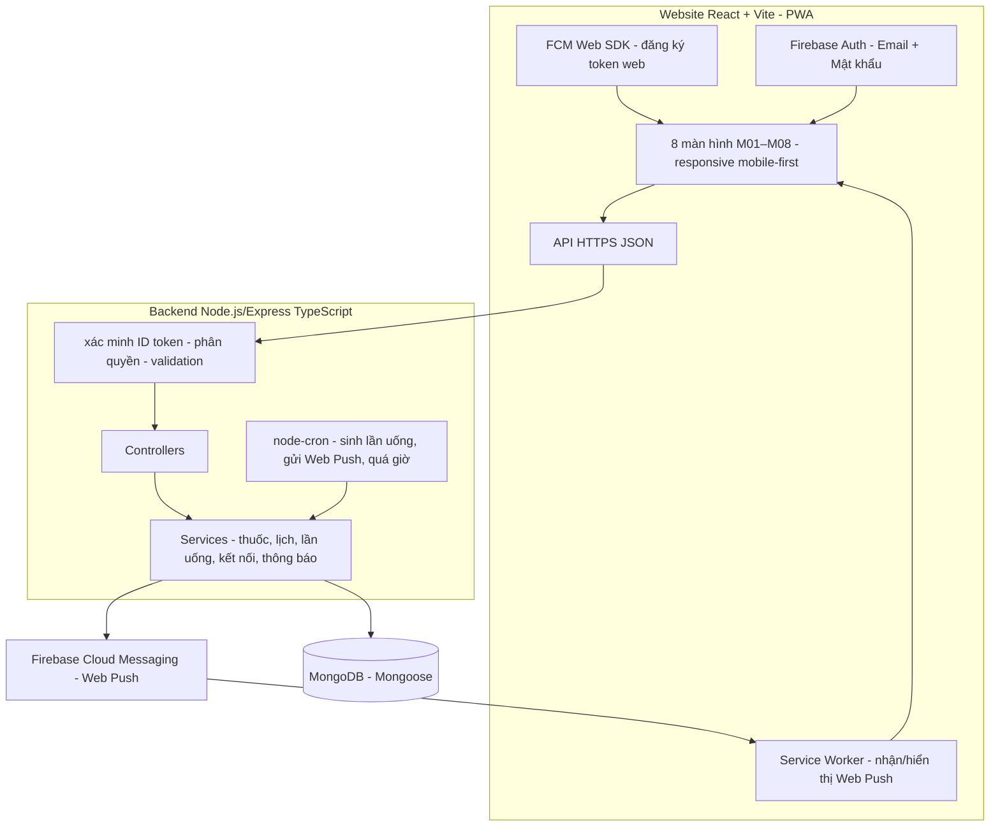

# ARCHITECTURE — Kiến trúc hệ thống

## 1. Sơ đồ tổng thể



## 2. Luồng chính

```mermaid
sequenceDiagram
    participant U as Người dùng
    participant App as Web (trang)
    participant API as Backend
    participant DB as MongoDB
    participant F as FCM Web Push
    participant L as Service Worker

    U->>App: Nhập email + mật khẩu
    App->>F: Firebase Auth xác thực
    F-->>App: ID token
    App->>API: API call kèm Authorization Bearer
    API->>API: Xác minh ID token (Firebase Admin)
    API->>DB: Đọc/ghi dữ liệu (kiểm tra chủ sở hữu)
    API-->>App: JSON phản hồi
    App->>F: Đăng ký token web (FCM Web SDK + quyền Notifications)

    Note over API,F,L: Giờ uống tới — server node-cron gửi Web Push (kênh chính)
    Note over L,App: Trang đang mở → hiện trong trang; bấm push → mở M02
    Note over API,F,L: Nhắc từ server khi quá giờ / thông báo người thân — FCM
```

## 3. Trách nhiệm từng lớp

| Thành phần | Trách nhiệm |
|---|---|
| Web (`web/`) | Giao diện M01–M08 responsive + khu vực vận hành `/admin` (ngoài M01–M08), đăng nhập Firebase, đăng ký token Web Push, hiển thị thông báo trong trang, gọi API, PWA manifest |
| Service Worker | Nhận Web Push từ FCM khi trang đóng/mở, hiển thị notification, bấm → mở M02; hủy notification đã hiển thị khi xác nhận |
| Backend | Xác minh ID token, phân quyền (chủ hồ sơ/người thân/admin), kiểm tra dữ liệu đầu vào, nghiệp vụ, cung cấp API, nhật ký thay đổi |
| Vận hành (`/api/v1/admin`) | `role='manager'` hoặc `'admin'`: số liệu chỉ đọc, danh sách người dùng không nội dung y tế, khóa/mở (đồng bộ Firebase + DB), xem lỗi gửi thông báo/nhật ký. Chỉ `admin`: đặt lại mật khẩu qua Firebase Admin và đổi vai trò |
| node-cron (src/jobs) | Chạy mỗi phút: sinh lần uống từ lịch, **gửi Web Push đúng giờ uống**, phát hiện quá giờ/bỏ qua |
| FCM (Web Push) | Kênh nhắc từ server: giờ uống, quá giờ, đồng bộ lịch, thông báo tới người thân |
| MongoDB | Lưu toàn bộ dữ liệu nghiệp vụ |
| Firebase Auth | Quản lý danh tính Email + Mật khẩu (Spark plan); không thay thế backend |

## 4. Lý do chọn công nghệ

| Công nghệ | Lý do |
|---|---|
| React + Vite + TypeScript | SPA nhanh, khởi động nhanh; TypeScript giảm lỗi; responsive mobile-first dùng được ngay trên điện thoại không cần cài app; dễ chia sẻ qua link cho người thân; cùng ngôn ngữ TypeScript với backend |
| Node.js + Express (TypeScript) | Cùng ngôn ngữ TypeScript với web; bất đồng bộ phù hợp I/O; đơn giản cho MVP |
| MongoDB + Mongoose | Quy tắc nghiệp vụ đảm bảo bằng atomic update (`findOneAndUpdate` với filter trạng thái) + unique index (một lần uống chỉ một xác nhận); Mongoose hỗ trợ TypeScript. Đổi từ MySQL theo yêu cầu người dùng 19/10/2026; standalone MongoDB không hỗ trợ multi-document transaction nên thao tác tạo thuốc nhiều collection không dùng transaction (chấp nhận cho MVP) |
| Web Push (FCM for Web + Service Worker) | Miễn phí trên Spark; server gửi được khi trang đóng; một cơ chế chạy trên mọi trình duyệt (desktop/mobile); node-cron có sẵn làm lịch nhắc tập trung — thay Notifee sau khi đổi nền tảng sang web (19/10/2026) |
| PWA (manifest + Service Worker) | Bắt buộc để Web Push hoạt động trên iOS Safari (“Thêm vào màn hình chính”); icon trên màn hình điện thoại cho cảm giác như app |
| node-cron | Đủ cho quy mô MVP (single instance); ít phụ thuộc hơn hàng đợi + Redis; dễ kiểm thử. Nếu mở rộng nhiều instance sẽ cân nhắc lại (ghi nhận trong mở rộng) |
| Firebase Auth Email + Mật khẩu | Miễn phí trên Spark plan; backend xác minh ID token chuẩn (Phone/OTP bị loại vì Spark không hỗ trợ) |

**Đánh giá kênh thông báo (yêu cầu của PLAN)**: **server (node-cron) gửi Web Push làm kênh chính** vì trình duyệt không tự nhắc khi tab đã đóng — lịch nhắc phải nằm tập trung ở server. Push hiển thị qua Service Worker; trang đang mở thì hiện ngay trong trang (banner + âm thanh) cho thao tác nhanh. Nhược điểm: Web Push phụ thuộc quyền trình duyệt, mạng và trên iOS Safari phải cài PWA — NOTIFICATION_PLAN.md nêu biện pháp và giới hạn.

## 5. Quy tắc kỹ thuật chung

- Toàn bộ API trong một backend Express. Mọi endpoint yêu cầu Firebase ID token hợp lệ, trừ endpoint health check được ghi rõ.
- Thời gian lưu UTC ở server; hiển thị theo múi giờ người dùng (mặc định Asia/Ho_Chi_Minh).
- Phản hồi JSON thống nhất: `{ success, data?, error? { code, message } }` — chi tiết ở API_SPEC.md.
- Log không chứa dữ liệu nhạy cảm, token, khóa dịch vụ, **mật khẩu do admin đặt lại**.
- Phân quyền vận hành kiểm tra ở `authMiddleware` (`users.role`) + `requireStaffMiddleware`/`requireAdminMiddleware`; không tin cờ phía client. Tài khoản có `disabled_at` bị chặn 403 trước khi vào route.
- Biến môi trường: `NODE_ENV`, `PORT`, `MONGODB_URI`, `FIREBASE_PROJECT_ID`, `TZ_DEFAULT` — mẫu ở `.env.example`.
- Cấu trúc thư mục:

```
backend/  src/config, src/middlewares, src/models, src/routes, src/controllers, src/services, src/jobs, src/utils, tests/
web/      src/screens (M01–M08 + Admin), src/components, src/services, src/store, src/hooks, src/theme, src/types, src/__tests__/, public/ (manifest.webmanifest, sw.js, icons)
docs/     tài liệu PLAN
```

---

## Điểm cần duyệt

1. Đánh giá “server node-cron gửi Web Push làm kênh chính, hiển thị trong trang khi trang mở” ở mục 4.
2. node-cron single-instance cho MVP — chấp nhận giới hạn nếu chạy đa instance sau này.
3. Cấu trúc thư mục backend/ + web/ ở mục 5.
