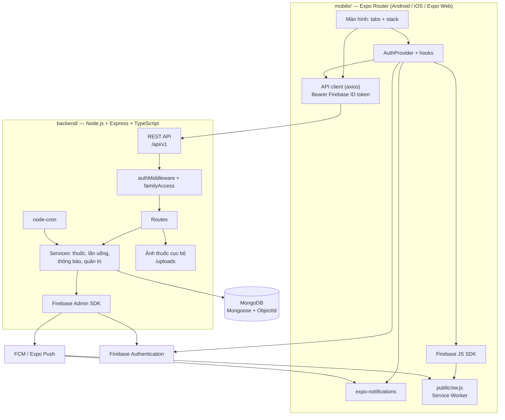
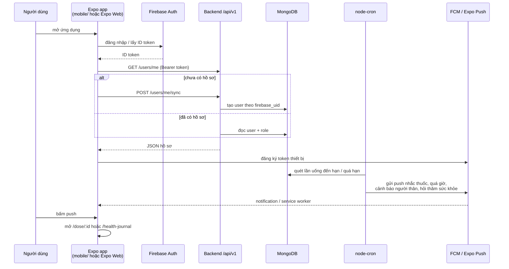

# ARCHITECTURE — Kiến trúc hệ thống

> Tài liệu này phản ánh mã nguồn hiện tại trong `mobile/` và `backend/`.
> Ứng dụng chính là Expo/React Native; Expo Web chỉ là một target phụ dùng chung mã nguồn `mobile/`.

## 1. Sơ đồ tổng thể



## 2. Luồng chính



## 3. Trách nhiệm từng lớp

| Thành phần | Trách nhiệm |
|---|---|
| `mobile/` | Ứng dụng Expo Router: đăng nhập Firebase, tabs Trang chủ / Lịch / Thuốc / Thông báo / Vận hành / Hồ sơ, các màn hình stack như `dose/[id]`, `medication/[id]`, `family`, `health-journal`, `settings`, `admin`. Gọi API bằng Bearer ID token. |
| Push native | `expo-notifications` trên Android/iOS: đăng ký token, tạo Android channel, hiển thị nút thao tác nhanh, mở deep link khi bấm. |
| Expo Web | Dùng chung mã nguồn Expo Router. `expo-notifications` không hỗ trợ web nên dùng Firebase JS SDK + `mobile/public/sw.js` để nhận FCM Web Push. |
| Backend | Xác minh Firebase ID token, kiểm tra tài khoản bị khóa, phân quyền chủ hồ sơ/người thân/manager/admin, validate dữ liệu, xử lý nghiệp vụ và trả JSON thống nhất. |
| `authMiddleware` + `familyAccess` | Gắn `userId`/`role`/`timezone`; `resolveOwnerAccess` kiểm tra `?ownerId=` và quyền `view_schedule` / `manage_medication`. |
| Services | `doseService`: sinh lần uống, chuyển trạng thái, confirm/snooze/cannot-take. `notificationService`: chọn payload, gửi push, chống trùng, ghi lịch sử. `adminService`: dashboard, khóa/mở, đổi vai trò, xóa tài khoản. |
| `node-cron` | Mỗi phút chuyển `pending → overdue` sau 30 phút và `→ missed` sau 120 phút; gửi push đến hạn, quá giờ, cảnh báo người thân và hỏi thăm sức khỏe. Mỗi ngày 00:00 sinh lần uống cho 7 ngày tới. |
| `Firebase Admin SDK` | Xác minh ID token, khóa/mở tài khoản Firebase, thu hồi refresh token, xóa user; gửi FCM. |
| `Firebase Authentication` | Quản lý danh tính email/mật khẩu; backend không lưu mật khẩu. |
| MongoDB + Mongoose | Lưu 12 collection nghiệp vụ; thời gian lưu UTC, hiển thị theo múi giờ người dùng. |
| `backend/uploads` | Lưu ảnh thuốc cục bộ; phục vụ qua `/uploads`. Không dùng Firebase Storage. |

## 4. Lý do chọn công nghệ

| Công nghệ | Lý do |
|---|---|
| Expo + React Native + Expo Router | Một mã nguồn cho Android/iOS và Expo Web; điều hướng file-based; phù hợp ứng dụng mobile-first và dễ mở rộng. |
| TypeScript | Dùng chung ngôn ngữ với backend, giảm lỗi hợp đồng API và kiểu dữ liệu. |
| Node.js + Express | Bất đồng bộ phù hợp I/O, đơn giản cho MVP, dễ tách route/service. |
| MongoDB + Mongoose | Mô hình tài liệu linh hoạt; atomic update (`findOneAndUpdate`) cho chuyển trạng thái lần uống; unique/partial index chống trùng. |
| Firebase Authentication | Đăng nhập email/mật khẩu, ID token chuẩn; backend xác minh bằng Firebase Admin. |
| FCM / Expo Push | Gửi push từ server khi app đóng; native dùng Expo Push/FCM, Expo Web dùng FCM Web Push + Service Worker. |
| node-cron | Đủ cho MVP một instance; không cần hàng đợi/Redis. Nếu chạy nhiều instance cần cơ chế khóa. |

## 5. Quy tắc kỹ thuật chung

- Toàn bộ API nghiệp vụ nằm dưới `/api/v1`; `/health` và `/uploads` nằm ngoài prefix này.
- Mọi endpoint dưới `/api/v1` đều đi qua `authMiddleware`; route tự yêu cầu `requireAuthMiddleware` hoặc `requireFirebaseAuthMiddleware`.
- Thời gian lưu UTC; ngày/giờ hiển thị theo `users.timezone` (mặc định `Asia/Ho_Chi_Minh`).
- Phản hồi JSON thống nhất: `{ success, data?, error? { code, message } }`.
- Log không chứa mật khẩu, token, khóa dịch vụ hay dữ liệu y tế nhạy cảm.
- Tài khoản có `disabled_at` bị chặn 403 trước khi vào route.
- Biến môi trường chính: `PORT`, `MONGODB_URI`, `TZ_DEFAULT`, `ENABLE_CRON`, `DOSE_GENERATION_DAYS`, `RELATIVE_ALERT_AFTER_MINUTES`, `WELLNESS_CHECK_AFTER_MINUTES`, `FIREBASE_*`, `CORS_ORIGIN`.
- Cấu trúc thư mục:

```text
backend/   src/config, middlewares, models, routes, services, jobs, utils, scripts
mobile/    src/app (Expo Router), src/components, services, store, hooks, theme, types, utils, public/
tools/     diagram-generator
docs/      tài liệu dự án và sơ đồ
```

## 6. Giới hạn hiện tại

- Push phụ thuộc quyền thông báo, mạng và chính sách hệ điều hành; có thể trễ.
- iOS native push cần tài khoản Apple Developer và cấu hình APNs.
- Expo Web cần HTTPS công khai để FCM Web Push hoạt động ổn định ngoài localhost/LAN.
- node-cron chỉ chạy trên một instance; chạy nhiều instance cần khóa phân tán.
- Phạm vi sức khỏe chỉ là tuân thủ uống thuốc và hỏi thăm cảm giác sau uống; không chẩn đoán hay tư vấn y tế.
