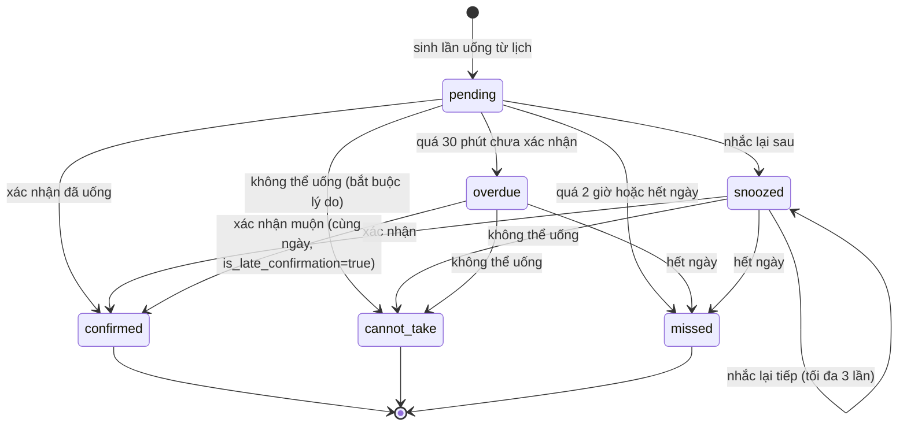

# BUSINESS RULES — Logic nghiệp vụ và giá trị mặc định

Các giá trị đánh dấu *(mặc định đề xuất)* cần người dùng duyệt (Q3, OPEN_QUESTIONS.md).

## 1. Trạng thái lần uống

### Điều kiện chuyển trạng thái

| Từ | Đến | Điều kiện |
|---|---|---|
| pending | confirmed | Người chủ hồ sơ gọi confirm; trong cùng ngày tính là xác nhận bình thường |
| pending | snoozed | Gọi snooze; `snooze_count < 3` và giờ nhắc lại còn trong ngày |
| snoozed | snoozed | Tiếp tục snooze; tổng số lần nhắc lại không vượt 3 |
| pending/snoozed/overdue | cannot_take | Gọi cannot-take kèm lý do (bắt buộc, 1–500 ký tự) |
| pending | overdue | node-cron: quá 30 phút kể từ `scheduled_at` mà chưa xác nhận *(đề xuất)* |
| overdue | confirmed | Xác nhận muộn trong cùng ngày — set `is_late_confirmation=true` |
| pending/snoozed/overdue | missed | node-cron: quá 2 giờ kể từ `scheduled_at` *(đề xuất)* hoặc đã sang ngày khác |
| bất kỳ | — | Không thể chuyển sang trạng thái đã kết thúc (confirmed, cannot_take, missed) |

### Quy tắc chống trùng

- Một lần uống chỉ có **một** bản xác nhận: unique `(schedule_id, scheduled_at)` + atomic update (`findOneAndUpdate`).
- Confirm đồng thời (hai yêu cầu song song): chỉ một kết quả thành công; yêu cầu kia nhận `409 CONFLICT` hoặc (nếu cùng `clientRequestId`) kết quả idempotent.
- Sửa lịch sử lần uống bằng API: **không có endpoint nào cho phép** sửa/ xóa `confirmed_at`, `status` đã kết thúc.

## 2. Nhắc lại (snooze)

| Quy tắc | Chi tiết |
|---|---|
| Giới hạn | Mặc định cách nhau **10 phút**, tối đa **3 lần**. Người dùng có thể chỉnh ở M08 (`users.preferences.snoozeMinutes` 5–30, `snoozeMax` 1–5) — backend tuân theo; thiếu/sai → mặc định |
| Không nhắc lại lần đã xác nhận | Snooze chỉ hợp lệ khi status ∈ {pending, snoozed, overdue} |
| Vượt quá hạn trong ngày | Nếu giờ nhắc lại vượt quá 23:59 giờ địa phương hoặc vượt `scheduled_at + 2 giờ`, server từ chối với `409 CONFLICT` |
| Thông báo | Mỗi lần snooze → server lên lịch gửi Web Push mới sau `snoozeMinutes`; push cũ không gửi lại |

## 3. Thay đổi lịch uống

| Quy tắc | Chi tiết |
|---|---|
| Hiệu lực | Lịch mới có hiệu lực từ `effectiveFrom`; các lần uống có `scheduled_at >= thời điểm lưu` dùng phiên bản mới |
| Lịch sử | Các lần uống đã xảy ra (pending trở đi đã có bản ghi) **không bị sửa**; giữ nguyên `schedule_version` cũ |
| Đổi lịch đang hoạt động | App yêu cầu xác nhận trước khi lưu; server tăng `current_version`, lưu snapshot vào `schedule_versions` |
| Nhắc giờ uống | Server (node-cron) tự tính lại push cho các lần uống tương lai theo phiên bản mới; không có thông báo cục bộ nào cần hủy ở client |
| Ngừng thuốc | Thuốc → `discontinued`; mọi lịch liên quan → `archived`; lần uống tương lai bị xóa; lần uống quá khứ giữ nguyên |

## 4. Sinh lần uống (node-cron)

- Chạy mỗi phút, quét lịch `status=active` có `effective_from <= ngày <= effective_to` (hoặc không thời hạn).
- Sinh `dose_occurrences` cho các ngày cần thiết (MVP: sinh trước 7 ngày).
- Gửi Web Push tại `scheduled_at` và các mốc snooze; bỏ qua nếu lần uống không còn ở trạng thái `pending/snoozed` (đã xác nhận, đã bỏ qua, hoặc lịch đã ngừng).
- Không sinh trùng: unique `(schedule_id, scheduled_at)`.
- node-cron chỉ chạy trên một instance (single-instance MVP); nếu mở rộng đa instance cần cơ chế khóa (ghi nhận).

## 5. Người thân

| Quy tắc | Chi tiết |
|---|---|
| Mã mời | 6 chữ số, có hạn *(15 phút — Q8)*; lưu SHA-256; mỗi lần tạo, mã cũ vô hiệu |
| Mã không đồng nghĩa quyền | Nhập đúng mã → tạo connection; connection mới chỉ có quyền được cấp khi chấp nhận |
| Kiểm tra quyền | Mọi thao tác xem/sửa kiểm tra tại backend; không tin client |
| Thu hồi | Ngắt kết nối hoặc đổi quyền → có hiệu lực ngay ở yêu cầu kế tiếp |
| Dữ liệu | Không gửi dữ liệu lịch/sức khỏe khi connection không `view_schedule` |
| Cảnh báo bỏ lỡ | Lần uống **chưa được xác nhận** quá `RELATIVE_ALERT_AFTER_MINUTES` phút (mặc định **15**, cấu hình ở `backend/.env`) → push cho người thân có `relative_alerts=true`. Mốc tính từ giờ đến hạn **cuối cùng** (`snoozed_until` nếu đã “nhắc lại sau”); đã xác nhận hoặc đánh dấu không thể uống → không báo; mỗi lần uống **một lần duy nhất** (chống trùng theo dose+kind) |
| Xem lịch hộ | Người thân có `view_schedule` xem được lịch uống (M03) và thuốc (M04) của chủ hồ sơ ở chế độ **chỉ xem** (`?ownerId=`); **không** ghi thay được lần uống (xác nhận/nhắc lại/không thể uống luôn dành cho chủ hồ sơ) |

## 6. Thống kê M01

- Tính theo **ngày hiện tại theo múi giờ người dùng** (`users.timezone`, mặc định Asia/Ho_Chi_Minh).
- `confirmed` = số lần có status = confirmed trong ngày.
- `remaining` = tổng lần trong ngày − confirmed − cannot_take − missed.
- Đúng cả khi “bữa nửa đêm”: ngày thống kê theo local date của người dùng, không theo UTC.

## 7. Nguyên tắc nghiệp vụ chung

1. Không suy luận liều lượng: mọi nội dung thuốc do người dùng nhập, website chỉ lưu/hiển thị.
2. Không có chỉ định y tế, không có cảnh báo y tế.
3. Mọi thao tác ghi quan trọng đều ghi `audit_logs` (tạo/sửa/ngừng thuốc, đổi lịch, kết nối/ngắt người thân).
4. Thông báo “đã gửi” ≠ “đã xác nhận uống” — tách bạch trong dữ liệu và UI.

---

## Điểm cần duyệt

1. Bảng giá trị mặc định: quá giờ 30 phút, snooze 10 phút × 3 lần, missed sau 2 giờ hoặc hết ngày.
2. Xác nhận muộn chỉ trong cùng ngày, đánh dấu `is_late_confirmation`.
3. Sinh trước 7 ngày các lần uống.
4. Quy tắc đổi lịch: không sửa lịch sử, sinh lại lần uống tương lai theo phiên bản mới.
5. Mã mời 6 chữ số, hạn 15 phút, mỗi lần tạo thì mã cũ vô hiệu.
