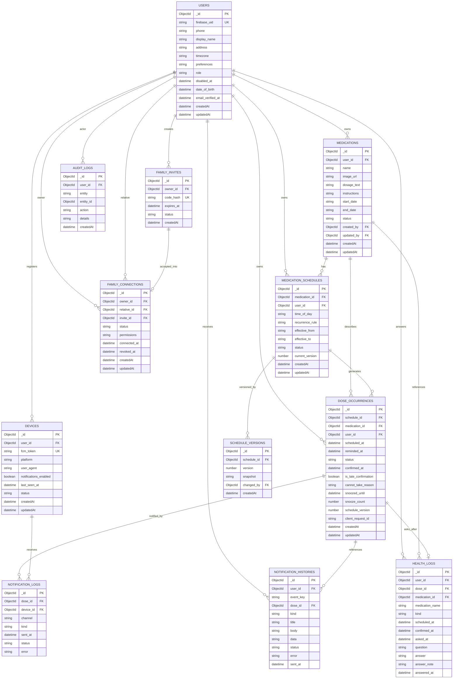

# DATABASE PLAN — MongoDB + Mongoose

> Tài liệu này phản ánh mô hình dữ liệu hiện tại trong `backend/src/models/`.
> Hệ thống dùng **MongoDB + Mongoose**, khóa chính là `_id` kiểu `ObjectId`.

## 1. Nguyên tắc

- Mọi collection dùng `_id` kiểu `ObjectId`; API trả về dạng chuỗi.
- Thời gian lưu UTC; ngày/giờ nghiệp vụ hiển thị theo `users.timezone` (mặc định `Asia/Ho_Chi_Minh`).
- Dữ liệu luôn gắn với chủ hồ sơ qua `user_id` hoặc `owner_id`; backend kiểm tra quyền trước mỗi lần đọc/ghi.
- Chuyển trạng thái lần uống dùng **atomic update** (`findOneAndUpdate` có điều kiện `status`) để tránh ghi đè lịch sử.
- Tạo thuốc + lịch + phiên bản lịch chạy tuần tự; MVP chấp nhận không dùng transaction đa tài liệu.
- Xóa thuốc = ngừng theo dõi (`status = discontinued`), không xóa lịch sử lần uống.
- Không lưu mật khẩu, khóa dịch vụ Firebase hoặc token nhạy cảm trong mã nguồn.
- Token thiết bị được lưu trong `devices` với trạng thái `active | invalid`.

## 2. Sơ đồ quan hệ (ER)

## 3. Mô tả collection

### 3.1 `users`

| Trường | Kiểu | Ghi chú |
|---|---|---|
| `_id` | ObjectId | Khóa chính |
| `firebase_uid` | String | Unique; UID Firebase Auth |
| `phone` | String? | SĐT hồ sơ, chuẩn hóa `0xxxxxxxxx` |
| `display_name` | String? | Tên hiển thị |
| `address` | String? | Địa chỉ liên hệ |
| `timezone` | String | Mặc định `Asia/Ho_Chi_Minh` |
| `preferences` | Mixed? | `snoozeMinutes` 5–30, `snoozeMax` 1–5; UI khác |
| `role` | String | `user | manager | admin`, mặc định `user` |
| `disabled_at` | Date? | Có giá trị = bị khóa; `authMiddleware` trả 403 |
| `date_of_birth` | Date | Bắt buộc |
| `email_verified_at` | Date? | Đồng bộ từ Firebase khi xác minh email |
| `createdAt`, `updatedAt` | Date | Timestamps |

Email không lưu trong MongoDB; Firebase Auth giữ email. Khu vực admin lấy email qua Firebase Admin khi cần hiển thị.

### 3.2 `medications`

| Trường | Kiểu | Ghi chú |
|---|---|---|
| `_id` | ObjectId | Khóa chính |
| `user_id` | ObjectId | Chủ hồ sơ |
| `name` | String | Tối đa 200 ký tự |
| `image_url` | String? | URL ảnh trong `/uploads` hoặc URL ngoài |
| `dosage_text` | String? | Liều dùng |
| `instructions` | String? | Hướng dẫn |
| `start_date` | String | `YYYY-MM-DD` |
| `end_date` | String? | `YYYY-MM-DD` |
| `status` | String | `active | discontinued` |
| `created_by`, `updated_by` | ObjectId | Người tạo/cập nhật |
| `createdAt`, `updatedAt` | Date | Timestamps |

### 3.3 `medicationschedules`

| Trường | Kiểu | Ghi chú |
|---|---|---|
| `_id` | ObjectId | Khóa chính |
| `medication_id` | ObjectId | Thuốc |
| `user_id` | ObjectId | Chủ hồ sơ |
| `time_of_day` | String | `HH:mm:ss` |
| `recurrence_rule` | String | Mặc định `daily` |
| `effective_from` | String | `YYYY-MM-DD` |
| `effective_to` | String? | `YYYY-MM-DD` |
| `status` | String | `active | archived` |
| `current_version` | Number | Mặc định 1 |
| `createdAt`, `updatedAt` | Date | Timestamps |

### 3.4 `scheduleversions`

| Trường | Kiểu | Ghi chú |
|---|---|---|
| `_id` | ObjectId | Khóa chính |
| `schedule_id` | ObjectId | Lịch được version |
| `version` | Number | Tăng dần |
| `snapshot` | Mixed | Ảnh chụp lịch tại thời điểm đổi |
| `changed_by` | ObjectId | Người đổi |
| `createdAt` | Date | Chỉ có createdAt |

### 3.5 `doseoccurrences`

| Trường | Kiểu | Ghi chú |
|---|---|---|
| `_id` | ObjectId | Khóa chính |
| `schedule_id` | ObjectId | Lịch sinh ra lần uống |
| `medication_id` | ObjectId | Thuốc |
| `user_id` | ObjectId | Chủ hồ sơ |
| `scheduled_at` | Date | Giờ đến hạn (UTC) |
| `reminded_at` | Date? | Lần nhắc gần nhất |
| `status` | String | `pending | confirmed | overdue | snoozed | missed | cannot_take` |
| `confirmed_at` | Date? | Thời điểm xác nhận |
| `is_late_confirmation` | Boolean | Xác nhận sau giờ hẹn nhưng cùng ngày địa phương |
| `cannot_take_reason` | String? | Lý do 1–500 ký tự |
| `snoozed_until` | Date? | Mốc nhắc lại |
| `snooze_count` | Number | Số lần đã nhắc lại |
| `schedule_version` | Number | Phiên bản lịch tại lúc sinh |
| `client_request_id` | String? | Chống gửi trùng khi confirm |
| `createdAt`, `updatedAt` | Date | Timestamps |

### 3.6 `devices`

| Trường | Kiểu | Ghi chú |
|---|---|---|
| `_id` | ObjectId | Khóa chính |
| `user_id` | ObjectId | Chủ thiết bị |
| `fcm_token` | String | Unique; token Expo/FCM |
| `platform` | String | `web | android | ios` |
| `user_agent` | String? | Thông tin trình duyệt/thiết bị |
| `notifications_enabled` | Boolean | Mặc định `true` |
| `last_seen_at` | Date? | Lần đăng ký/cập nhật gần nhất |
| `status` | String | `active | invalid` |
| `createdAt`, `updatedAt` | Date | Timestamps |

### 3.7 `familyinvites`

| Trường | Kiểu | Ghi chú |
|---|---|---|
| `_id` | ObjectId | Khóa chính |
| `owner_id` | ObjectId | Chủ hồ sơ tạo mã |
| `code_hash` | String | Unique; SHA-256 của mã 6 chữ số |
| `expires_at` | Date | Hạn 15 phút |
| `status` | String | `pending | accepted | revoked | expired` |
| `createdAt` | Date | Chỉ có createdAt |

### 3.8 `familyconnections`

| Trường | Kiểu | Ghi chú |
|---|---|---|
| `_id` | ObjectId | Khóa chính |
| `owner_id` | ObjectId | Chủ hồ sơ |
| `relative_id` | ObjectId | Người thân |
| `invite_id` | ObjectId | Mã mời đã dùng |
| `status` | String | `active | revoked` |
| `permissions` | Object | `view_schedule`, `manage_medication`, `relative_alerts` |
| `connected_at` | Date | Thời điểm kết nối |
| `revoked_at` | Date? | Thời điểm ngắt kết nối |
| `createdAt`, `updatedAt` | Date | Timestamps |

Mặc định quyền: `view_schedule=true`, `manage_medication=false`, `relative_alerts=true`.

### 3.9 `notificationlogs`

| Trường | Kiểu | Ghi chú |
|---|---|---|
| `_id` | ObjectId | Khóa chính |
| `dose_id` | ObjectId | Lần uống liên quan |
| `device_id` | ObjectId? | Thiết bị nhận |
| `channel` | String | `fcm | in_app` |
| `kind` | String | `scheduled_reminder | overdue | snooze | relative_alert | wellness_check | sync` |
| `sent_at` | Date | Thời điểm gửi/thử gửi |
| `status` | String | `sent | failed | expired` |
| `error` | String? | Mã/lỗi gửi |

### 3.10 `notificationhistories`

| Trường | Kiểu | Ghi chú |
|---|---|---|
| `_id` | ObjectId | Khóa chính |
| `user_id` | ObjectId | Người nhận |
| `event_key` | String | Khóa chống trùng theo người nhận |
| `dose_id` | ObjectId? | Lần uống liên quan |
| `kind` | String | Loại thông báo |
| `title`, `body` | String | Nội dung đã gửi |
| `data` | Mixed? | Payload deep link/action |
| `status` | String | `sent | failed | expired` |
| `error` | String? | Lỗi gửi |
| `sent_at` | Date | Thời điểm gửi |

### 3.11 `healthlogs`

| Trường | Kiểu | Ghi chú |
|---|---|---|
| `_id` | ObjectId | Khóa chính |
| `user_id` | ObjectId | Chủ hồ sơ |
| `dose_id` | ObjectId? | Lần uống được hỏi thăm |
| `medication_id` | ObjectId? | Thuốc liên quan |
| `medication_name` | String? | Tên thuốc tại thời điểm hỏi |
| `kind` | String | `wellness_check | note` |
| `scheduled_at`, `confirmed_at` | Date? | Mốc lần uống |
| `asked_at` | Date | Thời điểm gửi câu hỏi |
| `question` | String | Nội dung câu hỏi |
| `answer` | String? | `good | tired | dizzy | unwell | other` |
| `answer_note` | String? | Ghi chú thêm |
| `answered_at` | Date? | Thời điểm trả lời |

### 3.12 `auditlogs`

| Trường | Kiểu | Ghi chú |
|---|---|---|
| `_id` | ObjectId | Khóa chính |
| `user_id` | ObjectId | Người thực hiện |
| `entity` | String | `dose`, `medication`, `schedule`, `invite`, `user`... |
| `entity_id` | ObjectId | Đối tượng bị tác động |
| `action` | String | `confirm`, `create`, `admin_lock`... |
| `details` | Mixed? | Chi tiết không chứa mật khẩu/token |
| `createdAt` | Date | Chỉ có createdAt |

## 4. Index và ràng buộc chính

| Collection | Index / ràng buộc | Mục đích |
|---|---|---|
| `users` | `firebase_uid` unique | Một tài khoản Firebase ↔ một hồ sơ |
| `doseoccurrences` | `{ schedule_id, scheduled_at }` unique | Không sinh trùng lần uống |
| `doseoccurrences` | `{ user_id, scheduled_at }`, `{ user_id, status }` | Truy vấn lịch và trạng thái |
| `medicationschedules` | `{ user_id, status, effective_from }` | Lọc lịch đang hoạt động |
| `scheduleversions` | `{ schedule_id, version }` unique | Một phiên bản chỉ có một bản ghi |
| `devices` | `fcm_token` unique | Một token ↔ một thiết bị |
| `familyinvites` | `code_hash` unique | Không trùng mã đã hash |
| `familyconnections` | `{ owner_id, relative_id }` unique partial khi `status='active'` | Không kết nối trùng |
| `notificationhistories` | `{ user_id, event_key }` unique | Chống gửi trùng cho cùng người nhận |
| `healthlogs` | `{ dose_id }` unique partial khi có `dose_id` | Mỗi lần uống chỉ một mục hỏi thăm |

## 5. Quy ước thời gian và vòng đời dữ liệu

- `scheduled_at`, `confirmed_at`, `snoozed_until`, `asked_at`, `sent_at` lưu UTC.
- Ngày nghiệp vụ (`start_date`, `effective_from`, `effective_to`) là chuỗi `YYYY-MM-DD` theo múi giờ chủ hồ sơ.
- Lần uống quá 30 phút → `overdue`; quá 120 phút → `missed` (cron mỗi phút).
- Xác nhận muộn trong cùng ngày địa phương đặt `is_late_confirmation=true`.
- Hỏi thăm sức khỏe được tạo sau khi xác nhận 10 phút; mỗi lần uống chỉ có một `HealthLog`.
- Ngắt kết nối người thân đặt `status='revoked'` và `revoked_at`; không xóa lịch sử.
- Xóa tài khoản (admin) xóa dữ liệu liên quan trong MongoDB và Firebase user; thao tác được ghi audit.
