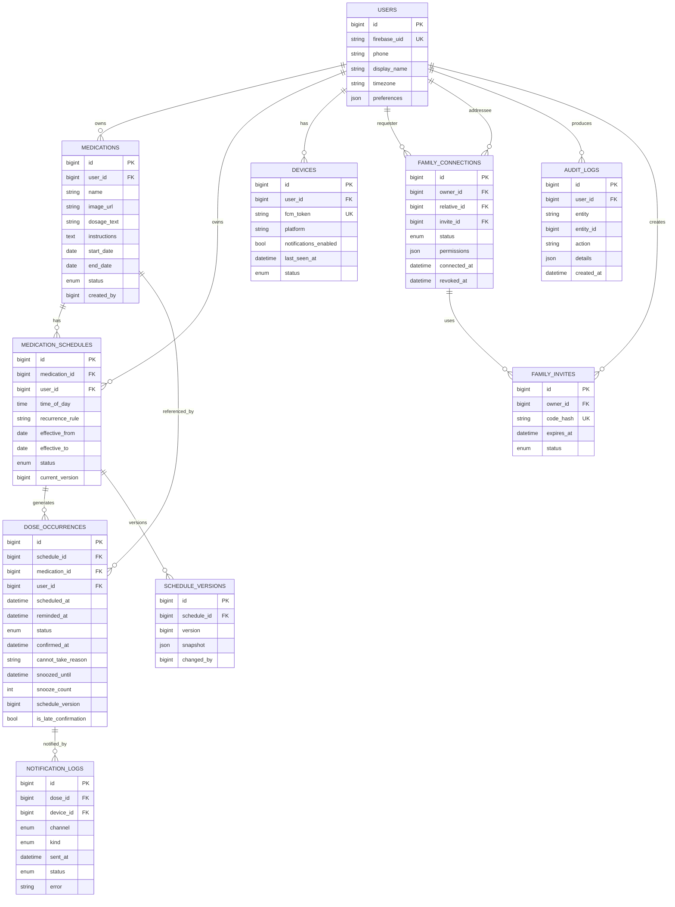

# DATABASE PLAN — MongoDB + Mongoose

> **Cập nhật 19/10/2026**: chuyển từ MySQL + Sequelize sang **MongoDB + Mongoose** theo yêu cầu người dùng. Tài liệu dưới đây mô hình quan hệ logic vẫn đúng; thay đổi khi triển khai:
>
> - `id` BIGINT auto-increment → `_id` ObjectId (API trả về dạng chuỗi).
> - Ràng buộc unique → unique index (đặc biệt `{schedule_id, scheduled_at}` cho lần uống, `{owner_id, relative_id}` partial index cho kết nối đang active).
> - Transaction multi-document → **atomic update** (`findOneAndUpdate` với filter trạng thái) cho chuyển trạng thái lần uống; standalone MongoDB không hỗ trợ transaction nên thao tác tạo thuốc (medication + schedules + versions) chạy tuần tự, chấp nhận cho MVP.
> - Collection: `users`, `devices`, `medications`, `medicationschedules`, `scheduleversions`, `doseoccurrences`, `familyinvites`, `familyconnections`, `notificationlogs`, `auditlogs`.

## 1. Nguyên tắc

- Mọi bản ghi có `_id` (ObjectId) và timestamps `createdAt`/`updatedAt`.
- Thời gian lưu kiểu `DATETIME` (UTC) ở server; hiển thị theo múi giờ người dùng (mặc định Asia/Ho_Chi_Minh).
- Mọi dữ liệu gắn với chủ sở hữu (`user_id`); backend kiểm tra quyền trước mọi đọc/ghi.
- Ràng buộc unique để một lần uống chỉ có một bản xác nhận; cập nhật trạng thái dùng atomic update (`findOneAndUpdate`).
- Không lưu mật khẩu, khóa dịch vụ Firebase hay token nhạy cảm trong mã nguồn; token FCM web (đăng ký qua Service Worker) lưu trong CSDL với trạng thái để hủy khi đăng xuất.
- Xóa thuốc = ngừng theo dõi (`status = discontinued`), không xóa lịch sử lần uống.

## 2. Sơ đồ quan hệ (ER)

## 3. Mô tả từng bảng

### 3.1 `users` — người dùng

| Trường | Kiểu | Ràng buộc | Mô tả |
|---|---|---|---|
| id | BIGINT UNSIGNED | PK, auto | |
| firebase_uid | VARCHAR(128) | UNIQUE, not null | UID Firebase Auth |
| phone | VARCHAR(20) | | Số SĐT đã xác thực |
| display_name | VARCHAR(100) | | Tên hiển thị |
| timezone | VARCHAR(50) | default 'Asia/Ho_Chi_Minh' | Múi giờ hiển thị |
| preferences | JSON | | Cỡ chữ, âm thanh, nhắc lại (M08). Hiện dùng: `snoozeMinutes` (5–30, mặc định 10), `snoozeMax` (1–5, mặc định 3) — backend tuân theo khi snooze |
| created_at / updated_at | DATETIME | | UTC |

### 3.2 `medications` — thuốc

| Trường | Kiểu | Ràng buộc | Mô tả |
|---|---|---|---|
| id | BIGINT UNSIGNED | PK | |
| user_id | BIGINT UNSIGNED | FK → users, index | Chủ hồ sơ |
| name | VARCHAR(200) | not null | Tên thuốc do người dùng nhập |
| image_url | VARCHAR(500) | nullable | Ảnh tùy chọn |
| dosage_text | VARCHAR(200) | | Liều theo đơn — text người dùng nhập, không suy luận |
| instructions | TEXT | | Hướng dẫn trước/sau ăn |
| start_date | DATE | not null | Ngày bắt đầu |
| end_date | DATE | nullable | Ngày kết thúc (null = không thời hạn) |
| status | ENUM('active','discontinued') | default 'active' | Ngừng = discontinued, không xóa |
| created_by / updated_by | BIGINT UNSIGNED | FK → users | Người tạo/sửa (có thể là người thân nếu có quyền) |

### 3.3 `medication_schedules` — lịch uống

| Trường | Kiểu | Ràng buộc | Mô tả |
|---|---|---|---|
| id | BIGINT UNSIGNED | PK | |
| medication_id | BIGINT UNSIGNED | FK → medications, index | |
| user_id | BIGINT UNSIGNED | FK → users, index | |
| time_of_day | TIME | not null | Giờ uống trong ngày |
| recurrence_rule | VARCHAR(100) | not null | Quy tắc lặp, MVP: 'daily' |
| effective_from | DATE | not null | Ngày hiệu lực đầu |
| effective_to | DATE | nullable | Ngày hiệu lực cuối |
| status | ENUM('active','archived') | default 'active' | Lịch mới thay lịch cũ → archive bản cũ |
| current_version | BIGINT | default 1 | Phiên bản hiện hành |

Index: `(user_id, status, effective_from)`.

### 3.4 `schedule_versions` — phiên bản lịch

| Trường | Kiểu | Mô tả |
|---|---|---|
| id | BIGINT UNSIGNED | PK |
| schedule_id | BIGINT UNSIGNED | FK → medication_schedules |
| version | BIGINT | 1, 2, 3…; unique theo (schedule_id, version) |
| snapshot | JSON | Toàn bộ nội dung lịch lúc phiên bản đó |
| changed_by | BIGINT UNSIGNED | FK → users |
| created_at | DATETIME | |

Lịch sử lần uống ghi `schedule_version` để không bị ảnh hưởng khi đổi lịch.

### 3.5 `dose_occurrences` — lần uống

| Trường | Kiểu | Ràng buộc | Mô tả |
|---|---|---|---|
| id | BIGINT UNSIGNED | PK | |
| schedule_id | BIGINT UNSIGNED | FK, index | |
| medication_id | BIGINT UNSIGNED | FK, index | |
| user_id | BIGINT UNSIGNED | FK, index | |
| scheduled_at | DATETIME | **UNIQUE (schedule_id, scheduled_at)** | Giờ dự kiến — chống sinh trùng |
| reminded_at | DATETIME | nullable | Giờ thực gửi nhắc |
| status | ENUM('pending','confirmed','overdue','snoozed','missed','cannot_take') | default 'pending' | Trạng thái lần uống |
| confirmed_at | DATETIME | nullable | Giờ xác nhận (server ghi) |
| is_late_confirmation | BOOLEAN | default false | Xác nhận muộn trong cùng ngày |
| cannot_take_reason | VARCHAR(500) | nullable | Bắt buộc khi status='cannot_take' |
| snoozed_until | DATETIME | nullable | Hạn nhắc lại cuối |
| snooze_count | INT | default 0 | Số lần đã nhắc lại |
| schedule_version | BIGINT | not null | Phiên bản lịch lúc sinh |
| created_at / updated_at | DATETIME | | |

Index: `(user_id, scheduled_at)` cho M01/M03; `(user_id, status)` cho thống kê.

### 3.6 `family_invites` — mã mời

| Trường | Kiểu | Ràng buộc | Mô tả |
|---|---|---|---|
| id | BIGINT UNSIGNED | PK | |
| owner_id | BIGINT UNSIGNED | FK → users | Người cao tuổi tạo mã |
| code_hash | VARCHAR(64) | UNIQUE | Băm SHA-256 của mã 6 chữ số — không lưu mã thô |
| expires_at | DATETIME | | Hạn dùng (mặc định 15 phút — chờ Q8) |
| status | ENUM('pending','accepted','revoked','expired') | default 'pending' | |
| created_at | DATETIME | | |

### 3.7 `family_connections` — kết nối người thân

| Trường | Kiểu | Ràng buộc | Mô tả |
|---|---|---|---|
| id | BIGINT UNSIGNED | PK | |
| owner_id | BIGINT UNSIGNED | FK → users | Chủ hồ sơ |
| relative_id | BIGINT UNSIGNED | FK → users | Người thân |
| invite_id | BIGINT UNSIGNED | FK → family_invites | |
| status | ENUM('active','revoked') | | Thu hồi = revoked, không xóa dòng |
| permissions | JSON | | `{"view_schedule": true, "manage_medication": false, "relative_alerts": true}` — `relative_alerts` = người thân nhận push khi chủ hồ sơ bỏ lỡ thuốc (NOTIFICATION_PLAN §3.4) |
| connected_at | DATETIME | | |
| revoked_at | DATETIME | nullable | |

UNIQUE: `(owner_id, relative_id)` khi status='active'.

### 3.8 `devices` — trình duyệt/thiết bị và token FCM web

| Trường | Kiểu | Ràng buộc | Mô tả |
|---|---|---|---|
| id | BIGINT UNSIGNED | PK | |
| user_id | BIGINT UNSIGNED | FK, index | |
| fcm_token | VARCHAR(512) | UNIQUE | Token Web Push (FCM for Web) |
| platform | ENUM('web') | | Web Push; phân biệt thiết bị bằng user agent |
| user_agent | VARCHAR(255) | nullable | Nhận diện trình duyệt/thiết bị (desktop, Android, iOS) |
| notifications_enabled | BOOLEAN | default true | |
| last_seen_at | DATETIME | | |
| status | ENUM('active','invalid') | default 'active' | Token hết hạn → invalid |

### 3.9 `notification_logs` — nhật ký thông báo

| Trường | Kiểu | Mô tả |
|---|---|---|
| id | BIGINT UNSIGNED | PK |
| dose_id | BIGINT UNSIGNED | FK → dose_occurrences |
| device_id | BIGINT UNSIGNED | FK → devices, nullable |
| channel | ENUM('fcm','in_app') | | FCM = Web Push; in_app = hiển thị trong trang khi trang đang mở |
| kind | ENUM('scheduled_reminder','overdue','snooze','relative_alert','sync') | | `overdue` = nhắc khi quá giờ (NOTIFICATION_PLAN §3.3) |
| sent_at | DATETIME | |
| status | ENUM('sent','failed','expired') | |
| error | VARCHAR(500) | nullable, không chứa token |

Phân biệt “đã gửi thông báo” với “người dùng đã xác nhận uống”.

### 3.10 `audit_logs` — nhật ký thay đổi

| Trường | Kiểu | Mô tả |
|---|---|---|
| id | BIGINT UNSIGNED | PK |
| user_id | BIGINT UNSIGNED | |
| entity | VARCHAR(50) | 'medication','schedule','connection','invite',… |
| entity_id | BIGINT UNSIGNED | |
| action | VARCHAR(50) | 'create','update','disconnect','revoke',… |
| details | JSON | Không chứa dữ liệu nhạy cảm |
| created_at | DATETIME | |

## 4. Ràng buộc kiểm tra (validation)

- `medications.name`: 1–200 ký tự; `start_date <= end_date` (nếu có).
- `medication_schedules.time_of_day`: hợp lệ 00:00–23:59; `effective_from <= effective_to`.
- `dose_occurrences.cannot_take_reason`: bắt buộc khi status = 'cannot_take'.
- `family_invites.code_hash`: đúng định dạng SHA-256 hex.
- Cập nhật `dose_occurrences` trạng thái: dùng atomic update (`findOneAndUpdate` + filter `status` hiện tại) theo bảng chuyển trạng thái ở BUSINESS_RULES.md.
- Một lần uống chỉ một bản xác nhận: unique `(schedule_id, scheduled_at)` + atomic update khi confirm.

## 5. Chính sách lưu giữ

- Không tự động xóa lịch sử.
- Xóa tài khoản: theo Q4 (đề xuất xóa cứng toàn bộ dữ liệu liên quan trong 30 ngày sau yêu cầu).
- `audit_logs` giữ tối thiểu 1 năm.

## 6. Kế hoạch migration

| Migration | Nội dung | Giai đoạn |
|---|---|---|
| 001 | users, devices | 2 |
| 002 | medications, medication_schedules, schedule_versions | 3 |
| 003 | dose_occurrences | 3 |
| 004 | family_invites, family_connections | 5 |
| 005 | notification_logs, audit_logs | 3–5 |

---

## Điểm cần duyệt

1. 7 nhóm bảng và các trường ở trên (không có bảng sức khỏe — theo phạm vi đã chốt).
2. ENUM trạng thái lần uống: pending, confirmed, overdue, snoozed, missed, cannot_take.
3. Chính sách lưu giữ ở mục 5 (phụ thuộc Q4).
4. Mã mời lưu dạng băm SHA-256, không lưu mã thô.
